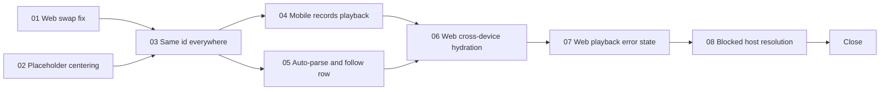

# Execution order

Context: [00-SUMMARY.md](./00-SUMMARY.md). Prompts to paste: [COPY-PASTA.md](./COPY-PASTA.md).

## Phases

| Phase | Prompts | Parallel | Why this order |
| --- | --- | --- | --- |
| 1 | 01, 02 | Yes | Both are standalone fixes. 01 stops the episode 275 swap before any other playback work. |
| 2 | 03 | No | Every later prompt depends on the new id. It also carries the only migration. |
| 3 | 04, 05 | Yes | 04 is mobile only. 05 is worker, ORM follow service, and the web Add by RSS pages. |
| 4 | 06 | No | Needs mobile writing rows (04), the new id (03), and the feed change event (05). |
| 5 | 07 | No | Needs 06's player load path to show the error on the right item. |
| 6 | 08 | No | Plugs into 07's error state and 02's `Image` structure. |
| 7 | Close | No | Done at the end of 08's turn: archive, cumulative verification. |

## File ownership

A prompt edits only the files it owns. A parallel prompt that needs a change in another prompt's
files records it in its final message instead.

| Prompt | Owns |
| --- | --- |
| 01 | `apps/web/src/hooks/usePlayAddByRSS.tsx`, `playbackHandoffState.ts`, `useMediaPlayerControllerQueueHeadLoading.ts` and its tests, `tools/web/seed-e2e.mjs` only if the seed user lacks a now-playing directory item, one new web E2E spec |
| 02 | `packages/ui/src/components/image/Image/**`, `.../ImageNonReact/**`, caller `*.module.scss` only if a caller styles the placeholder image itself, one new web E2E spec |
| 03 | `packages/helpers/src/lib/addByRSSHash.ts`, `packages/parser-mapping/src/addByRSS/**`, `apps/web/src/utils/addByRSS/itemIndex.ts` and storage reads, new `apps/api/src/lib/addByRSSResourceData.ts`, API Add by RSS queue, playlist, and playback event controllers, `packages/orm` queue and playlist resource services, migration `0020`, baselines, readiness markers, `tools/web/seed-e2e.mjs`, `apps/web/e2e/helpers/seedConstants.ts`, web Add by RSS rows and headers that call `getAddByRSSHashId`, docs naming the hash |
| 04 | `apps/mobile/**`, detail doc 745, the 745 row in `phase-2/001-MASTER-PLAN-PHASE-2.md` |
| 05 | `apps/workers/src/commands/mq/rss/runAddByRSSParser.ts`, `packages/orm/src/services/account/accountFollowingAddByRSSChannel.ts`, a channel title and image function extracted in parser-mapping if needed, `apps/web/src/components/AddByRSS/List/**` and `.../Detail/**`, `apps/web/src/utils/addByRSS/{actions,sync}.ts`, new `firstParse.ts`, `backgroundRefresh.ts`, `feedChangedEvent.ts`, new `apps/web/src/hooks/useAddByRSSFeedChanged.ts`, the mount point in `apps/web/src/providers/` |
| 06 | `apps/web/src/utils/addByRSS/playFromQueueResource.ts` and `itemIndex.ts`, `usePlayAddByRSS.tsx`, the Add by RSS branch and identity helper in the queue head hook, `buildMinimalAddByRSSItemFromResourceData` in parser-mapping, a metadata-only update in `apps/web/src/contexts/MediaPlayer.tsx` if needed |
| 07 | `apps/web/src/contexts/MediaPlayer.tsx`, `NonLiveMediaOrchestrator.tsx`, `useMediaElementBridge.ts`, `mediaPlayerPlayMediaWhenReady.ts`, `MediaPlayer/Buttons/PlayButton*.tsx`, new error modal and `apps/web/src/utils/media/playbackErrorCopy.ts`, `useAddByRSSMediaFailureNotice.ts`, `packages/i18n-catalog/{consumer,mobile}/originals/*.json`, `actionErrorDetailLine` moved to `packages/helpers` (and its import in `apps/mobile/src/feedback/actionErrorCopy.ts`), `add-by-rss-credentials-media-message.spec.ts` |
| 08 | `packages/helpers-backend/src/fetchWithTimeout.ts`, new `apps/web/src/app/api/resolve-media-url/route.ts`, new `apps/web/src/utils/media/resolveMediaUrl.ts`, the 07 error path, `packages/ui/src/components/image/{Image,ImageNonReact,ImageRuntime}/**`, `apps/web/src/providers/Providers.tsx`, `tools/test-assets/src/{asset-server,constants}.ts`, the web E2E server env |

Every prompt appends its own entry to `release-notes/scratchpad.md`. Append only; never edit
another entry. A merge conflict there keeps both sides.

## Rollout notes for the operator

- **Migration 0020** rehashes `queue_resource` and `playlist_resource` rows and deletes duplicates
  it creates. 03 regenerates the `0004`/`0005` baselines and bumps
  `API_EXPECTED_MIGRATION_FILENAME` and `MANAGEMENT_API_EXPECTED_MIGRATION_FILENAME`. Push
  `infra/k8s/` changes to the Argo CD tracked branch so the cluster syncs.
- **Ship web and API together with 03.** An old web build talking to a new API still works: the
  API recomputes every hash from the payload, so the client value is advisory.
- **Mobile store build.** 04 changes mobile behavior. The alpha app records Add by RSS playback
  only after the next store binary.
- **Muse AI.** After 08 ships, play the test feed on alpha web. If artwork or audio still fails,
  open the browser network panel and check the final hop's `Cross-Origin-Resource-Policy`.

## Model choices

| Prompt | Model | Reasoning | Why |
| --- | --- | --- | --- |
| 01 | Opus 5.5 | high | Playback reconciliation across tabs and devices; easy to reintroduce a swap. |
| 02 | Cursor Grok 4.7 | high | UI and SCSS across many call sites, clear spec. |
| 03 | Opus 5.5 | high | Destructive data migration, JS-to-SQL hash parity, cross-surface id contract. |
| 04 | Opus 5.5 | high | Native playback recording, offline outbox ordering, device data. |
| 05 | Codex 5.3 | high | Worker, ORM, and web changes against a precise contract. |
| 06 | Opus 5.5 | high | In-place metadata upgrade without reloading audio; cross-device position. |
| 07 | Codex 5.3 | high | Multi-package error state and an i18n layer move. |
| 08 | Codex 5.3 | high | Security-sensitive route (SSRF on every hop) with a clear spec. |
| Close | (in 08) | — | 08 archives the set and lists the cumulative commands. |
