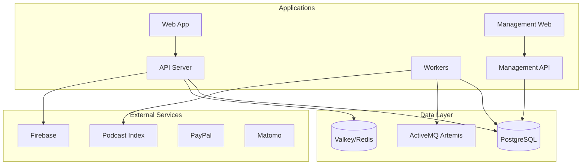
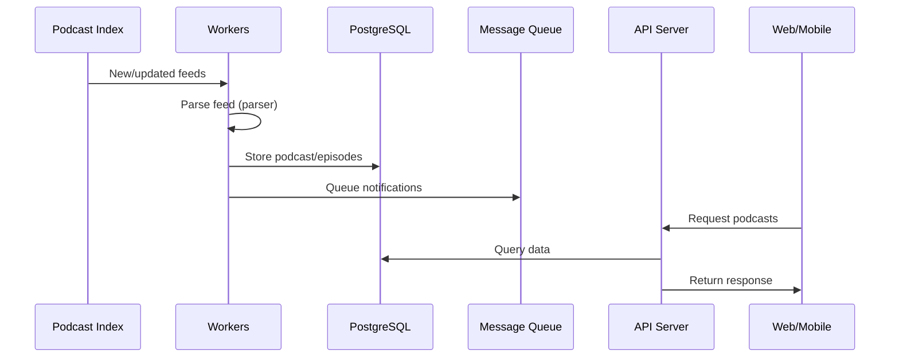

# Podverse Architecture

## System Overview



## Data Flow

### Feed Parsing Pipeline



### User Authentication

- Firebase Authentication for user management
- JWT tokens for API authentication
- Session management via Valkey/Redis

## Module Dependency Order

| Tier | Packages                                                                                                                                                 | Depends On                                                                            |
| ---- | -------------------------------------------------------------------------------------------------------------------------------------------------------- | ------------------------------------------------------------------------------------- |
| 1    | helpers, v4v-metaboost, v4v-helpers                                                                                                                      | (none)                                                                                |
| 2    | helpers-validation, helpers-requests, helpers-backend, helpers-browser, helpers-config                                                                   | helpers                                                                               |
| 3    | external-services-alby, external-services-firebase, external-services-paypal, external-services-strike, external-services-podcast-index, orm, v4v-btc-ln | helpers, helpers-\*                                                                   |
| 4    | notifications, billing, parser                                                                                                                           | helpers, helpers-\*, external-services-firebase, external-services-podcast-index, orm |
| 5    | mq                                                                                                                                                       | helpers, helpers-\*, external-services-podcast-index, orm, parser                     |
| 6    | api, web, workers, management-\*                                                                                                                         | various                                                                               |
| 7    | qa                                                                                                                                                       | helpers, helpers-\*, external-services-\*, orm, parser                                |

## Build Order

```
1. helpers, v4v-metaboost, v4v-helpers (parallel)
2. helpers-validation, helpers-requests, helpers-backend, helpers-browser, helpers-config (parallel)
3. external-services-alby, external-services-firebase, external-services-paypal, external-services-strike, external-services-podcast-index (parallel)
4. orm, parser-mapping (parallel)
5. notifications, billing
6. parser
7. mq
8. apps (parallel)
9. qa
```

**Note:** The 5 specialized helper packages can build in parallel with each other because they only depend on core `helpers`, not on each other.

## Directory Structure

```
packages/                 # Publishable npm packages (@podverse/*)
  helpers/                # Core utilities, types, DTOs, mediums
  v4v-metaboost/          # V4V MetaBoost feed type and mbrss-v1 helper utilities
  v4v-helpers/            # V4V payment-agnostic: recipient split and amount calculation
  helpers-validation/     # Validation utilities (email, password, URL, etc.)
  v4v-btc-ln/             # Bitcoin Lightning: lnaddress, keysend/blip10, web payments
  helpers-requests/       # API request types, query params, ApiRequestService
  helpers-backend/        # Backend-specific utilities (logger, timers, OS)
  helpers-browser/        # Browser-specific utilities (clipboard)
  helpers-config/         # Configuration validation utilities
  external-services-alby/       # Alby Sandbox + LNURL (V4V)
  external-services-firebase/   # Firebase (Google) integration
  external-services-paypal/     # PayPal integration
  external-services-strike/     # Strike integration
  external-services-podcast-index/  # Podcast Index API integration
  orm/                    # Database entities, services, migrations
  parser-mapping/         # Partytime-to-Podverse mapping (compat)
  notifications/          # Push notification services (Firebase)
  billing/                # Payment processor registry and billing event processing
  parser/                 # RSS/Podcast feed parsing
  mq/                     # Message queue operations

apps/               # Deployable applications
  api/              # REST API (Express)
  web/              # Web app (Next.js)
  workers/          # Background job processors
  management-api/   # Admin API
  management-web/   # Admin dashboard

tools/              # Development tools
  qa/               # Test data generation

infra/              # Infrastructure
  config/           # Environment templates
  database/         # Migrations and seeds
  docker/           # Docker compose files
```

## Database

### Technology

- PostgreSQL 16+
- TypeORM for ORM layer
- Entities defined in `packages/orm/src/entities/`

### Key Entities

- **Podcast** - Podcast feed metadata
- **Episode** - Individual episodes
- **User** - User accounts
- **MediaRef** - User-created clips/soundbites
- **Playlist** - User playlists
- **Subscription** - Podcast subscriptions

### Caching

- Valkey (Redis) holds the API and worker caches and carries account events over pub/sub (see
  Account events below).
- API response caching for high-traffic endpoints

## External Service Integrations

### Podcast Index

- Feed discovery and updates
- Podcast metadata enrichment
- Used by workers for feed synchronization

### Firebase

- Push notifications (FCM)
- User authentication
- Configured via `packages/notifications/`

### Billing

Premium membership is sold through PayPal, Strike, the App Store, and Google Play. The
processor charges the buyer. Podverse records the result in a grant ledger. Overview,
sandbox setup, and operations: [docs/billing/BILLING.md](/docs/billing/BILLING.md).

### Matomo

- Analytics tracking
- Privacy-respecting alternative to Google Analytics

## Message Queue

### Technology

- ActiveMQ Artemis
- STOMP protocol for messaging

### Queues

- Feed parsing jobs
- Notification delivery
- Background processing tasks

### Configuration

- Queue definitions in `packages/mq/`
- Worker processors in `apps/workers/`

## Account events

`GET /account/events` is the account's one server-sent events stream. Web tabs share one stream
per browser profile. The mobile app holds one in the foreground, and in the background while it
plays audio. Event names are namespaced: `notification.*` is in use, and `playback.*` is in use
for cross-device playback, described under Cross-device playback below. Those playback events are
latest-value state and one-shot control commands. Neither kind carries an SSE id or replays.
Clients ignore names they do not know. The client contract is
[`accountEventStream.ts`](/packages/helpers/src/lib/accountEventStream.ts).

A process writes notification state through `@podverse/orm`
(`AccountNotificationService.createMany`, `AccountService.updateNotificationsLastReadAt`, and
`publishAccountNotificationReadOne` for marking one notification read). After the write commits,
the ORM publishes a small account event (account
id, type, and ids) on the Redis channel `podverse:account-events` through the publisher that
process registered. Each API pod holds one subscriber connection, loads the rows and unread count
for accounts with open streams, and writes SSE events to them.

Who publishes:

- API pods, the management API, and the worker commands that write notifications. Those commands
  are `ACCOUNT_NOTIFICATION_WRITER_COMMANDS` in
  `apps/workers/src/lib/startup/categoriesForCommand.ts`. What Redis they need is in
  [workers ENV](/apps/workers/ENV.md).
- Each opens one dedicated publisher connection, separate from any cache connection, and registers
  it at startup.
- A process that writes notifications with none registered logs a warning at startup and on every
  dropped batch, and the write throws in tests.

A publish failure never fails the write. Redis being down does not stop the management API or the
writing workers; they drop events until the publisher reconnects. The API still refuses to start
when its cache connection cannot reach Valkey. Clients catch up on reconnect: every connection
starts with a `notification.state` snapshot, and only events with an SSE id
(`notification.created`) replay from `Last-Event-ID`, up to 50. A larger gap sends
`notification.resync` instead of the rows. If a pod's subscriber drops, its open streams replay
from the last delivered notification id and then receive a fresh state snapshot.

To add an event type, add its data to `AccountEventDataByType` in
[`accountEventPublisher.ts`](/packages/orm/src/lib/accountEventPublisher.ts), publish it after the
write commits, and add its handler in
[`apps/api/src/lib/accountEventStream/`](/apps/api/src/lib/accountEventStream/). Latest-value types
carry no SSE id and send a snapshot on connect instead of replaying. One-shot command types carry
no SSE id either and are never replayed, so a client that was disconnected never acts on a stale
command. A type that needs replay needs a new SSE id format, because ids are notification ids.

Proxy requirements for the stream are in [APPS-API.md](/apps/api/APPS-API.md). Environment
variables: [API](/apps/api/ENV.md), [management API](/apps/management-api/ENV.md), and
[workers](/apps/workers/ENV.md).

### Cross-device playback

One device per account plays at a time (exclusive active-device handoff). A device is a login
session. The playing device is the source of truth: it publishes its item, status, position,
playback rate, and whether the item is live, on every change and every 10 seconds while playing.
Other connected devices show that state and move their progress bar forward locally
(`estimatePlaybackPositionSeconds`). What they show is display only and writes no history or
position on them.

These routes all need a membership:

- `POST /account/playback/presence` checks in every 15 seconds while the event stream is open.
- `POST /account/playback/state` publishes, claims, or releases.
- `POST /account/playback/commands` sends target-state commands.
- `POST /account/playback/commands/{command_id}/start-failed` reports that the target could not
  start audio.

`playback.snapshot` is sent on connect and after the API recovers its Redis subscription.
`playback.state` and `playback.devices` are sent on change, ordered by `revision`.
`playback.command` goes to the target device only. `playback.start_failed` goes to the sender
only. None of them carries an SSE id. Commands expire after 5 seconds and are never replayed.

Commands name the target state: play, pause, seek to a position, set a rate, next, previous, play
an item, and take over. Next and previous are commands, and there is no toggle command, so two
devices pressing at once agree. The playing device runs next and previous the same way as its own
Next and Previous buttons, on its own queue. Skip forward and back are seeks the sender computes.
Live items allow play, pause, next, previous, play an item, and take over. Take over starts a live
item at the live point. Seek, skip, and rate are not commands for a live item.

Presence in Redis lasts 40 seconds after the last check-in. A cleanly closed stream leaves the
device list within about 5 seconds. A device that vanishes leaves within about 50 seconds. When
the playing device leaves, the state stays, paused, with no active device.

Commands never edit a server queue. The playing device writes now-playing through the queue routes
as it does for a local pick, which also makes that queue the account's active one. Queue edits
from other devices use the queue routes directly.

The contract and shared helpers are
[`accountPlaybackStream.ts`](/packages/helpers/src/lib/accountPlaybackStream.ts) and
[`crossDevicePlayback.ts`](/packages/helpers/src/lib/crossDevicePlayback.ts). Request calls are
[`playback.ts`](/packages/helpers-requests/src/api/account/playback.ts). The Redis store and
service are in [`apps/api/src/lib/accountPlayback/`](/apps/api/src/lib/accountPlayback/). Delivery
is in the account event stream hub.

## Add-by-RSS

Users can follow RSS feeds (podcasts, music) not in the main directory. Feeds may use optional HTTP Basic Auth; each device holds the credentials and sends them per request (the API seals them into a short-lived queue envelope for the worker), and the server keeps only a `requires_credentials` flag. See [ADD-BY-RSS](/docs/features/ADD-BY-RSS.md) for details and environment notes.

## OPML import / export

Users can export subscribed and add-by-RSS feeds as OPML, and import an OPML file via an async
server job (DB → Podcast Index → add-by-RSS resolution, 50/hr new-work limit). See
[OPML](/docs/features/OPML.md).
