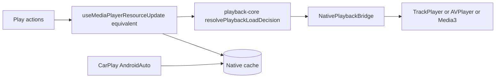
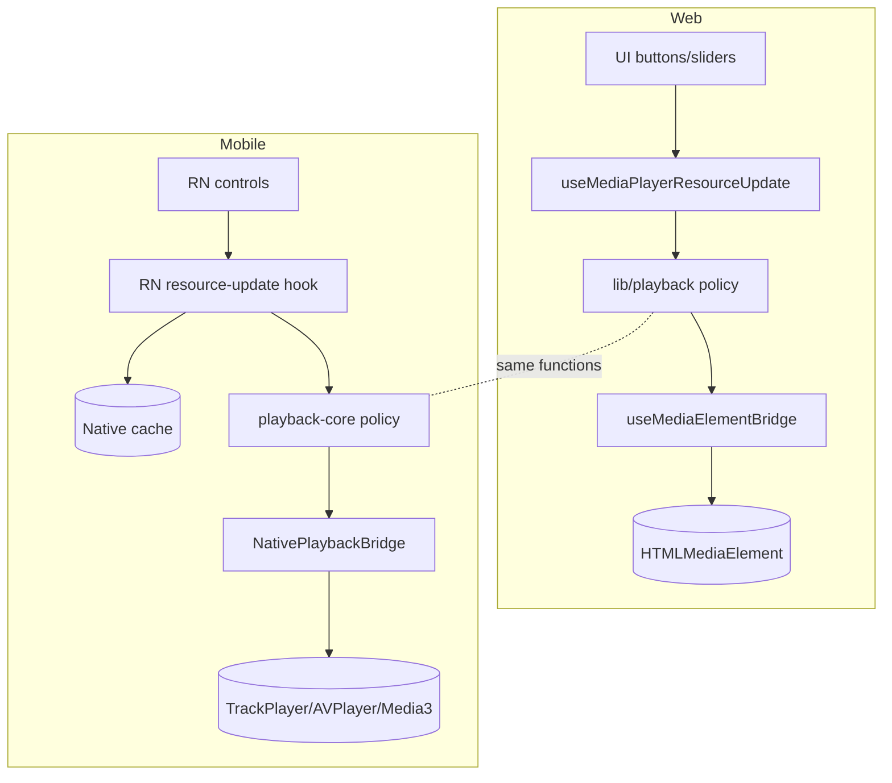
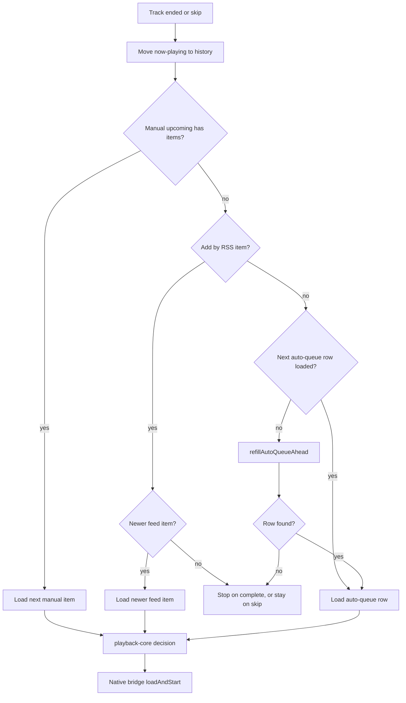

# Playback, queue, auto-queue, and playlist parity

This is the deep-dive proposal for mirroring Podverse web's most sophisticated product areas —
playback policy, manual queue, auto-queue, and playlist-driven play — on mobile. Read the foundation
first: [DOCS-MOBILE-PROCESS-OVERVIEW.md](DOCS-MOBILE-PROCESS-OVERVIEW.md) and the parity matrix in
[DOCS-MOBILE-PROCESS-SHARED-VS-DIVERGENT.md](DOCS-MOBILE-PROCESS-SHARED-VS-DIVERGENT.md).

## 1. Executive summary

- **Reuse the pure policy.** The web playback **decision engine** is platform-agnostic and should be
  extracted to `@podverse/playback-core` (see
  [DOCS-MOBILE-MONOREPO-TARGET-STRUCTURE.md](/docs/proposals/mobile/monorepo-llm-setup/DOCS-MOBILE-MONOREPO-TARGET-STRUCTURE.md)).
- **Reuse the same API sequences.** The manual queue calls the same `req*` wrappers and endpoints
  as web. Auto-queue source choice and walks are shared code in `@podverse/playback-core`
  (`./autoQueue`, `./autoQueueWalk`, `./addByRSSListWalk`); each client passes its own fetchers.
- **Replace only the transport.** Swap the DOM `useMediaElementBridge` for a **native** audio bridge,
  and feed a **native cache** so CarPlay/Android Auto work with the app closed.

## 2. Web architecture recap (cited)

Per [media-player-architecture SKILL](/.cursor/skills/media-player-architecture/SKILL.md), non-live
playback is layered:

| Layer             | Location                                                                      | Role                                                     |
| ----------------- | ----------------------------------------------------------------------------- | -------------------------------------------------------- |
| Policy (pure)     | `apps/web/src/lib/playback/`                                                  | Seek/resume/auto-play/pause-at decisions                 |
| Bridge (DOM)      | `apps/web/src/hooks/useMediaElementBridge.ts`, `mediaElementBridgeSurface.ts` | Only place that touches `HTMLMediaElement`               |
| Controls          | `apps/web/src/contexts/MediaPlayerControls.tsx` (`useMediaPlayerControls`)    | UI → bridge; `seek`, `jumpBy`, `pauseAt`, `loadAndStart` |
| Orchestration     | `NonLiveMediaOrchestrator`, `NonLiveMediaMount`                               | Ended/next/history, stats, queue advance                 |
| State             | `apps/web/src/contexts/MediaPlayer.tsx` (`applyPlaybackLoad`)                 | Now-playing DTOs, pending decision                       |
| Decision contract | `apps/web/src/components/MediaPlayer/MEDIA-PLAYER-DECISION-MATRIX.md`         | Documented decision matrix                               |

The architecture deliberately isolates **pure policy** from the **DOM bridge** — which is exactly
what makes mobile reuse feasible.

## 3. Mobile target architecture

The mobile hook layer and native bridge are new; the **policy** is shared.

## 4. `packages/playback-core` role

| Moves to `playback-core`                              | Stays in `apps/web`                | New in `apps/mobile`                                           |
| ----------------------------------------------------- | ---------------------------------- | -------------------------------------------------------------- |
| `resolvePlaybackLoadDecision.ts` + types              | `useMediaElementBridge` (DOM)      | Native playback bridge                                         |
| `playbackTarget.ts`, `playbackLoadRequest.ts`         | `MediaPlayerControls` context      | RN controls/store                                              |
| `resumeSeekFromAbridged.ts`, `clampNearEndSeconds.ts` | `NonLiveMediaMount` (portal)       | RN player UI                                                   |
| `combineQueueNowPlayingAndUpcoming.ts`                | orchestrator DOM binding           | RN orchestration hook                                          |
| enclosure-switch decision helpers                     | `parsePlaybackSeconds` wiring      | —                                                              |
| `autoQueue`, `autoQueueWalk`, `addByRSSListWalk`      | `createWebAutoQueueSourceFetchers` | `autoQueueRepository.createSourceFetchers`, `useAutoQueueFill` |

Both clients call the **same** decision functions; only the binding to a media engine differs.

## 5. Playback policy parity checklist

The policy is keyed on `PlaybackTarget.kind` (from
`apps/web/src/lib/playback/playbackTarget.ts`). Mobile must handle every variant identically:

| `PlaybackTarget.kind` | Meaning                     | Mobile handling                                                                                       |
| --------------------- | --------------------------- | ----------------------------------------------------------------------------------------------------- |
| `item-podcast`        | Standard podcast episode    | Resume from abridged position; auto-play per policy                                                   |
| `item-video`          | Video episode               | Same resume; native video surface                                                                     |
| `item-music`          | Music track (with `intent`) | Music forces `currentTime = 0`; honor `session_restore`/`explicit_play`/`fresh_transition`            |
| `clip`                | Clip within an item         | Start at clip start; `pauseAt` clip end                                                               |
| `soundbite`           | Soundbite                   | Start/`pauseAt` soundbite bounds                                                                      |
| `chapter`             | Chapter                     | Seek to chapter start                                                                                 |
| `add-by-rss`          | Ad-hoc RSS resource         | Load from `AddByRSSResourceData`; no server queue id; next and previous walk the feed (newer / older) |
| `livestream`          | Live                        | Deferred (native HLS, separate effort)                                                                |

The `intent` discriminator (`MusicItemPlaybackIntent`) must be preserved for stats/side effects, per
the decision matrix doc.

## 6. Manual queue parity

Server endpoints live in `apps/api/src/routes/queue.ts`; typed wrappers in
`packages/helpers-requests/src/api/queue/` (`queue.ts`, `queueResource/`). Web hooks:

- `useQueueResourcesLoadActive.tsx` — resolve active queue by medium, fetch now-playing + upcoming
- `useQueueResourceUpdateNowPlaying.tsx` — POST now-playing + update abridged index + anon snapshot
- `useQueueResourceMoveNowPlayingToHistory.tsx` — move completed/skipped item to history
- `useMediaPlayerControllerQueueHeadLoading.ts` — react to queue head / auto-queue row changes
- `combineQueueNowPlayingAndUpcoming` (`apps/web/src/lib/queue/`) — merge now-playing + upcoming

**Mobile flow (parallel):**

1. On launch, hydrate queue state from the **offline-first repository** (SQLite), then background-sync
   all queues + abridged index (same wrappers web uses in SSR). Screens must not call `req*`
   directly — see
   [DOCS-MOBILE-DATA-LAYER-OFFLINE.md](/docs/proposals/mobile/initial-decisions/DOCS-MOBILE-DATA-LAYER-OFFLINE.md).
2. Resolve the active queue by `medium_id` (reuse `getQueueForMedium` from `@podverse/helpers`).
3. Load now-playing + upcoming via the repository (which uses the same `queueResource` wrappers).
4. On play action → run `playback-core` decision → native bridge `loadAndStart`.
5. On add-to-queue (next/last) → optimistic local write + same POST wrappers; update queue store.
6. On ended/skip → move now-playing to history (same wrapper), advance head; write native cache when
   Track 12 is ready.

## 7. Abridged index / resume

Web builds a `QueueResourcesAbridgedIndex` (positions/durations for resume) — bootstrapped via SSR
in `apps/web/src/app/layout.tsx` (`reqQueueResourcesGetAllByAccountAbridged`), then kept current by
`useQueueResourcesAbridgedIndexLoad.tsx` / `useQueueResourcesAbridgedIndexUpdate.tsx`. Resume seek is
computed by `resumeSeekFromAbridged` (moving to `playback-core`).

**Mobile:** hydrate the abridged index from the **local DB** on launch, soft-refresh from the API
via the queue repository (no SSR), keep it in the queue store, and update it on now-playing
changes — same DTO shape, same resume math.

## 8. Auto-queue parity

Auto-queue is a **client-only prefetch buffer**. Web holds it in
`apps/web/src/contexts/AutoQueue.tsx` and fills it from
`apps/web/src/hooks/useAutoQueueLoadResources.tsx`. Mobile holds the rows in `AutoQueueProvider`,
with synchronous refs in `useAutoQueueFill`. `writeAutoQueueState` is the only writer.

The shared helper owns source choice, the forward fill, repeat wrap, paging, dedupe, the
playable-row check, and the backward walk (`fillAutoQueueForward`, `fillAutoQueueAhead`,
`resolveAutoQueuePrevious` in `@podverse/playback-core`). Web and mobile call it with their own
fetchers: `createWebAutoQueueSourceFetchers` on web, and `autoQueueRepository.createSourceFetchers`
on mobile. Those fetchers call:

- **Playlist** (`playlist_id_text` set): list position, or shuffle.
- **Channel** (no playlist): publish date for a podcast, season order for an album, or shuffle.

Repeat and shuffle persist on web as the `aqc.rd` / `aqc.rp` cookies, and on mobile as the same
keys in device prefs (AsyncStorage). Row 0 is the item playing. Later rows are the fill ahead of
it.

Mobile fills right after every load that has a seed (`refillAutoQueueAhead` in `playTarget`),
after Shuffle or Repeat, and on a Next press or `ended` when no next row is loaded. One gate keeps
one fill in flight per playing item and drops a result for an item that is not the one playing.

**Agreed difference — Next.** Web never disables Next. Mobile turns Next on once the manual queue
for the playing medium, a found auto-queue row, or a newer Add by RSS feed item exists, and keeps
it off at the true end.

**Previous.** Chapters come first. Inside a chapter, a tap past 3 seconds returns to that
chapter's start, and a tap inside 3 seconds steps to the previous chapter. With no chapter left,
or with no chapters, a tap past 3 seconds restarts the item. The hold and the remote command skip
that restart and leave the item. Previous then steps back through played auto-queue rows. Before
row 0 it loads the previous playlist row, album track (season order), or episode (publish date),
with the buffer cleared and the config kept. With shuffle on, that walk only restarts. Account
queue history is not used.

**Add by RSS.** Next and Previous walk the playing item's feed on this device. Episodes are newest
first by publish date. Livestreams follow the feed page's channel order. Next is the newer item
and Previous is the older one. Mobile rebuilds the walk from the playing item after each load
(`useAddByRssFeedWalk`, `buildAddByRssFeedWalk`). Web keeps the list context from the play
that loaded the item.
Next and `ended` both check the manual queue first.

## 9. Playlist integration

Playing from a playlist row seeds the auto-queue config (`playlist_id_text` + shuffle/repeat). Web
list rows (e.g. `CommonEpisodeListRow`) call `reqQueueResourceItemAddNext` / `...AddLast` and pass a
`newAutoQueueConfig`. Playlist pages live under `apps/web/src/app/playlist/` and `playlists/`; wrappers
in `packages/helpers-requests/src/api/playlist/` (`playlist.ts`, `playlistResource/`).

**Mobile:** a playlist row's play action seeds the same auto-queue config and calls the same queue
wrappers; the native UI differs, the behavior matches.

## 10. Anonymous playback

Web persists an anonymous now-playing snapshot to `localStorage` (consent-gated) via
`apps/web/src/utils/anonymousPlaybackStorage.ts`. The snapshot shape is portable.

**Mobile:** persist the same snapshot to secure/async storage so anonymous users get resume behavior;
reconcile to the server queue on login.

## 11. Native car layer (summary)

CarPlay and Android Auto must work when the JS app is suspended or closed. The native services read a
**native cache** (queue, downloads, library index) that the JS side writes whenever queue/library
state changes. Full design:
[DOCS-MOBILE-CARPLAY-ANDROID-AUTO.md](/docs/proposals/mobile/initial-decisions/DOCS-MOBILE-CARPLAY-ANDROID-AUTO.md).
The JS write-path is the auto-queue/queue store from sections 6–8; the read-path is native.

The native advance window (`advance-window.json`) carries the play order after the playing item:
manual upcoming for that medium, then up to 10 automatic rows. Those are auto-queue rows resolved
by the shared helper (items, clips, and soundbites with their ranges), or the next Add by RSS
episodes from the shared feed walk as plain media URLs. JS rewrites it after every load, refill,
and queue change, and the in-app fill keeps 10 rows ahead for it.

With JS gone, the engine steps through the list and makes no choices of its own.

When JS returns it adopts the playing item. If the item is in the device's copy of the account
queue, the whole saved auto-queue buffer is restored with its active row, the same as the
`preserve` directive a manual-queue load (`playQueueResource`) uses. Otherwise, if the item is one
of the rows the window was built from, the saved auto-queue buffer (or Add by RSS feed) continues
from it with the same settings; otherwise JS refills from the item's own podcast or album.

**Agreed difference:** a car Queue tab start keeps the saved source, while a tap on the phone's
queue screen clears the auto-queue. The car start behaves as a manual-queue play.

**Agreed difference:** web has no native window; mobile needs one because native code cannot run
the TypeScript walk. Another client reuses `fillAutoQueueAhead` with its own fetchers; a native
client reads the advance window.

## 12. Testing parity

- **Unit:** playback-core tests under `packages/playback-core/src/__tests__/` validate decisions
  independent of platform, including `autoQueueWalk.test.ts` and `addByRSSListWalk.test.ts`.
  Mobile covers the fill gate in `apps/mobile/src/playback/autoQueueFillGate.test.ts` and the Add
  by RSS feed order in `apps/mobile/src/lib/addByRss/feedWalk.test.ts`.
- **API integration:** the queue/playlist endpoints already have API coverage; mobile reuses the
  same server, so no new API tests are required for reuse.
- **Mobile E2E:** Maestro/Detox flows mirroring web E2E areas (`apps/web/e2e/media-player-*.spec.ts`
  as **reference**, not reuse): play, resume, queue add/next, auto-queue advance, playlist play.
  `apps/mobile/e2e/auto-queue-advance.yaml` waits until full-player Next is enabled
  (`full-player-skip-next`), then skips.

## 13. Known deferrals

- **Livestream HLS:** web plays livestreams through a native element with `hls.js`
  (`MediaPlayerControllerLiveStream*`); native HLS is a
  separate effort (parallels the web livestream HLS migration).
- **Embed mode:** web-only chromeless player; out of scope for mobile.
- Car-started items outside the advance window get no app-closed automatic continuation, and
  livestreams stay manual-queue only.

## Diagram: web vs mobile playback stack

## Diagram: queue + auto-queue on ended/skip

